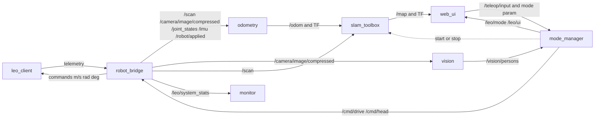

# LEO2 architecture

The robot does not run ROS. It opens one session to the server, receives `config/robot.yaml`'s client section, and turns physical commands into throttle. The server is six ROS 2 nodes plus `slam_toolbox`, which is started only while a mode asks for a map.

## Where each node lives

| Node | Folder | What it does | Main loop |
|---|---|---|---|
| `robot_bridge` | `src/server/leo_server/nodes/robot_bridge/` | ZeroMQ session, clock sync, ROS topics | 100 Hz poll, 50 Hz command repeat |
| `mode_manager` | `src/server/leo_server/nodes/mode_manager/` | The only owner of the mode and of behaviour state | `modes.tick_hz` (50 Hz) |
| `odometry` | `src/server/leo_server/nodes/odometry/` | 2D fusion, `/odom`, `odom -> base_link` | `odometry.publish_hz` (50 Hz) |
| `vision` | `src/server/leo_server/nodes/vision/` | YOLO pose, only on a new camera stamp | camera rate |
| `web_ui` | `src/server/leo_server/nodes/web_ui/` | Operator pages. Publishes input, never ticks control | HTTP |
| `monitor` | `src/server/leo_server/nodes/monitor/` | Live graph, per-node FPS, system FPS, client FPS | 1 Hz measure, page at 2 Hz |
| `slam_toolbox` | external, spawned by `slam_process.py` | Map and `map -> odom`. A new process is a new map | scan rate |

`node.py` in each folder is the `rclpy` node. The other files in that folder are plain Python and are what the tests import.

The client is `src/client/leo_client/`. `session.py` is the whole runtime. `hardware/` talks to the camera, lidar and servos. `sim/` is the mock robot and uses the same session.

Shared wire types are `src/shared/leo_protocol/`.

## How the nodes connect



Launch file: `src/server/launch/leo.launch.py`. It passes `--config` and sets `LEO_CONFIG`. It does not copy the yaml into the install tree. Static TF comes from `geometry` in that same file:

- `base_link -> laser` at the lidar mount
- `base_link -> head_base` at the head mount

`robot_bridge` then publishes `head_base -> head_yaw -> camera` from the measured pan and tilt.

`/cmd/drive` and `/robot/applied` use `ackermann_msgs/AckermannDriveStamped` when that package is installed. Otherwise both ends use `geometry_msgs/TwistStamped`: `linear.x` is m/s and `angular.z` is steering radians. `common/drive.py` is the only place that chooses.

`slam_toolbox` uses `base_frame: base_link` and `odom_frame: odom`. Its parameters are the `slam_toolbox` section. `mode_manager` writes them to `logs/slam_toolbox_runtime.yaml` only when it spawns the process. That file is generated output, not a second config.

## TF tree

```text
map -> odom -> base_link -> laser
                         -> head_base -> head_yaw -> camera
```

- `map -> odom` is published by `slam_toolbox` while a SLAM mode is active.
- `odom -> base_link` is published by `odometry`. It is not fed back from the map.
- The other transforms are static or follow the head joints.

## Wire protocol

Handshake port `5551` is the only number fixed in code (`leo_protocol.HANDSHAKE_PORT`). `robot.yaml` must use the same port; the loader rejects anything else. Telemetry and command ports travel in the handshake reply.

| Socket | Bind | Connect | Payload |
|---|---|---|---|
| REP / REQ `5551` | server | client | `hello` in, `config` out |
| SUB / PUB telemetry | server | client | msgpack header plus JPEG bytes |
| PUB / SUB command | client | server | `speed_mps`, `steering_rad`, `head_pan_deg`, `head_tilt_deg` |

Ranges are float32 bytes, not a list of numbers. A scan is sent once per revolution. A JPEG is sent only when the frame stamp changes. Joints and client FPS go out at `client.telemetry_hz`.

`robot_bridge/clock_sync.py` maps the robot's monotonic clock onto ROS time by keeping the smallest `ros_time - client_time` sample. Scans are stamped with the capture time, not the time the server happens to publish them.

The client converts commands with `calibration.py`:

- speed: piecewise map from m/s to motor throttle, so 0 m/s is the motor's neutral throttle
- steering: radians to throttle, with the invert flag
- head: degrees plus the servo zero, clamped to the limits

Until the first command arrives the actuators stay on that neutral output. If commands then stop, speed ramps from `watchdog.timeout_ms` to `watchdog.critical_ms` and the head stays where it is.

## Modes

`ModeController` in `modes.py` holds the mode string. The node exposes it as the ROS parameter `mode` and publishes it on `/leo/mode`. The client, the bridge and the HTML do not branch on it.

| Mode | Drive | Head | SLAM | Vision |
|---|---|---|---|---|
| `pause` | stop | hold | no | no |
| `teleoperation` | keyboard, only while control is enabled | mouse | no | no |
| `teleop_slam` | keyboard | mouse | yes | no |
| `staring` | keyboard | track a stable person, else mouse | no | yes |
| `silly_following` | steer from head pan, lidar avoid | track, else search | no | yes |
| `autonomy_profile_1` | stop, remembers a target | hold | no | no |

`drive.py`, `head.py` and `person_tracker.py` are the shared pieces. `staring` and `silly_following` both use `PersonTracker` and one `FriendDB`.

On a switch the controller throws away the behaviour objects and builds new ones from the latest measured joint angles. Held keys, the search sweep, the follow phase and a stored autonomy target all go away. Entering a SLAM mode restarts `slam_toolbox`, so the previous map is gone, and calls `/odometry/reset`. That service drops the scan-match history and widens the covariance. It does not zero the pose, and it does not move the servos. Leaving a SLAM mode stops the slam process.

The mode always starts at `pause`. Nothing is written to a state file.

## Odometry and the fusion slot

`odometry/tracker.py` is the pipeline:

1. Grow covariance by `process_noise_*`.
2. If `kinematic_enabled`, apply the Ackermann step from `/robot/applied` as a prediction. `/robot/applied` is the speed and steering the client actually used, including the watchdog scale and a scripted route.
3. If `imu_enabled`, call `measure_imu`.
4. If `encoder_enabled`, call `measure_encoder`.
5. If `visual_enabled`, call `measure_visual`.
6. On each new `/scan`, run point-to-line ICP against the previous scan and correct the pose. The match is composed onto the pose at the previous scan, so it does not add a second copy of the kinematic step.

`measure_imu`, `measure_encoder` and `measure_visual` in `sources.py` return nothing today. To add a sensor, make the matching function return a `PoseMeasure` (world x, y, yaw and two variances) and set its `*_enabled` flag in `robot.yaml`. The tracker already calls them. A visual source should consume whatever pose delta the camera pipeline publishes; the head is on pan/tilt, so that delta is only meaningful while the head is held still or the delta is expressed in `base_link`.

This replaces the old loop where slam_toolbox's own pose was published back as `odom -> base_link`.

Lidar scans are resampled on the robot onto one fixed counter-clockwise grid: `angle_min = -pi`, `increment = 2 pi / num_rays`. Empty bins and the rear blind zone are NaN. slam_toolbox keeps the first scan's angle model, so later scans have to share it. `minimum_travel_distance` and `minimum_travel_heading` are 0.1, and the laser range is clipped to the real lidar.

## Mock robot

`sim:=room` runs `python -m leo_client --sim room`. The session is the real one. `sim/hardware.py` replaces the camera, lidar and servos. Physics takes the throttle the client just wrote and converts it back with `calibration.py`, then steps an Ackermann model. The lidar is a numpy ray cast. The camera is a column renderer: wall height from distance, head pan turns the view, head tilt moves the horizon. Ground truth is sent on the telemetry debug field and republished as `/sim/ground_truth`.

Worlds and the scripted route are `sim.worlds` and `sim.route` in `robot.yaml`.

## Monitor

Every LEO node uses `common/heartbeat.py` and publishes `/leo/heartbeat` (`node`, `fps`) at 1 Hz. The monitor also counts raw messages per topic, so `slam_toolbox` gets a rate without a heartbeat. The page is `http://<host>:<monitor.port>/` and the same page at `/graph`. It shows:

- each node, stale or live, with its FPS
- the rate on each topic edge
- system FPS: telemetry packets per second at `robot_bridge` (the sense side of the loop)
- client FPS: the loop, camera and lidar rates from the robot, kept separate from the system number

## Config

`leo_server/common/config.py` is the only loader. A missing file, a missing key or an unknown key raises `ConfigError`. There are no default numbers in the loader. Tests override fields in memory instead of keeping a second yaml.

`data/friends.json` is runtime data. Its path is `modes.friends_db`.
